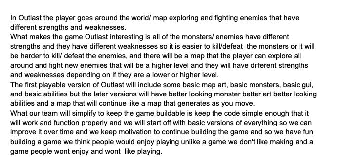

# GameDevGroup1
# Outlast
## Player
## The player will explore around the map and fight enemies that have different strengths and weaknesses 

## Docs
[OutlastDocs](https://github.com/Archaicxavier/Outlast/tree/main/docs)

## Goal 
### Fight Monsters and defeat 1 or more bosses to beat the game
## Core Action
### Fighting monsters, Surviving,  leveling up, and fighting stronger monsters with better new abilities and strategies.
## Challenge
#### Monsters attack with various abilities that you must play around by using your own abilities. Some monsters may have higher defense requiring you to use abilties while others counter abilities and force you to use physical damage.
## Feedback
#### Sound will play when damage is dealt or taken, and the health bar or text may change color if your character is on low health. There will be sounds that differ for using abilities or basic attacks for both you and the enemy. The Player changing animations based off of what is being done, Using abilities, Or just fighting with your fists.
## Scope

## GUI Mockups:

## Class Diagram:

## Pitch Document:

